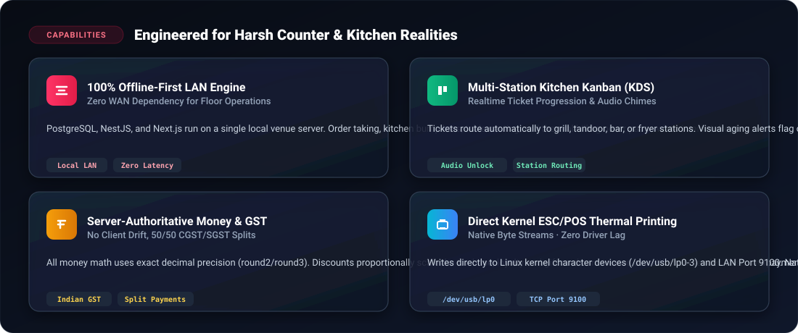
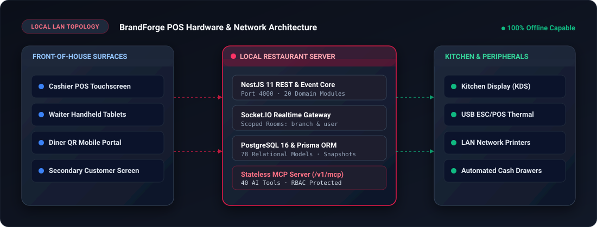

<div align="center">


<br/><br/>

<p align="center">
  
</p>

**Open-source, offline-first Restaurant POS & Operations Suite**  
Fast touch billing with **UPI QR payments**, dynamic floor management, Kitchen Display (KDS), online table reservations, inventory recipe costing, **staff attendance & payroll**, accounting, and multi-branch control. Runs 100% on your own local LAN server with zero subscriptions and zero mandatory cloud dependencies.

<br/>

[](./LICENSE)
[](package.json)
[](pnpm-workspace.yaml)
[](apps/web/tsconfig.json)
[](apps/backend)
[](apps/web)
[](casaos/README.md)

Maintained by **BrandForge Media**

<br/>

[Quick Start](#-quick-start) ·
[Feature Bento](#-core-capabilities) ·
[Hardware & Printing](#-hardware--thermal-printing) ·
[Architecture](#-network--system-architecture) ·
[Live Gallery](#-visual-showcase) ·
[License](#-license--attribution)

</div>

---

## ⚡ What is BrandForge Media POS?

**BrandForge Media POS** is an enterprise-grade, purpose-built Restaurant Management System engineered for restaurants, cafés, cloud kitchens, bakeries, bars, and multi-outlet chains. 

The entire stack — PostgreSQL 16, NestJS API, and Next.js frontend — runs on a single local server on the restaurant's LAN:
- **Zero Internet Dependency**: Order-taking, kitchen tickets, table seating, and thermal billing operate without internet connectivity.
- **Server-Authoritative Money**: Currency math, Indian GST splits (CGST + SGST), discounts, tips, and inventory deductions are computed strictly on the backend.
- **Granular RBAC**: 40+ atomic permissions guarding every operational mutation.
- **Native Hardware Integration**: Direct USB thermal printing (`/dev/usb/lp*`), network socket printing (Port 9100), and cash drawer kicks.

---

## 🍱 Core Capabilities

<p align="center">
  
</p>

---

## 🏛️ Network & System Architecture

BrandForge POS operates as a self-contained local appliance. A single machine on the restaurant's LAN runs the backend, database, and web server. All counter tills, waiter tablets, kitchen bump bars, and diner phones communicate over high-speed local Wi-Fi / Ethernet without pinging the cloud.

<p align="center">
  
</p>

---

## 📸 Visual Showcase

<div align="center">

### 1. High-Speed Touch POS & Visual Cart
*Fast order entry with modifier groups, table drafts, discount application, split billing, and UPI QR display.*


---

### 2. Live Kitchen Display System (KDS Kanban)
*Station-routed tickets, prep aging timers, bump-bar progression, and audible alerts.*


---

### 3. Interactive Multi-Floor Canvas & Waitlist
*Visual table management, occupancy states, drag-and-drop layouts, and live party queues.*


---

### 4. Executive Analytics & Sales Intelligence
*Real-time revenue metrics, product mix trends, food waste analysis, and payment breakdowns.*


---

### 5. Inventory, Recipe Costing & Procurement
*FIFO stock batch consumption, ingredient purchase orders, supplier management, and waste logging.*


---

### 6. Accounting Ledger & Daily Cash Reconciliation
*Opening floats, cash drop verifications, till variance audits, and Indian GST reporting.*


</div>

---

## 🚀 Quick Start

<p align="center">
  
</p>

### 1. Docker Compose (Recommended)

Run the full stack with a single command:

```bash
# Clone the repository
git clone https://github.com/baerozgaarmard/brandforge-pos.git
cd brandforge-pos

# Run automated installer
chmod +x install.sh
./install.sh
```

Or start manually with Docker Compose:

```bash
docker compose up -d
```

The app will be live at:
- **Web App / POS / Backoffice**: `http://localhost:1995`
- **Default Login**: Email `owner@brandforge.local` / Password `password123`

---

### 2. Manual Development Setup

Prerequisites: **Node.js >= 22**, **pnpm >= 9**, and **PostgreSQL 16**.

```bash
# Install dependencies
pnpm install

# Configure environment
cp .env.example .env

# Run database migrations and seed data
pnpm --filter backend prisma migrate deploy
pnpm --filter backend prisma db seed

# Start development servers
pnpm dev
```

---

## 🖨️ Hardware & Thermal Printing

BrandForge Media POS communicates directly with raw hardware without third-party print drivers:

1. **Direct USB Printing (Linux)**: Writes directly to kernel printer devices (`/dev/usb/lp0` through `/dev/usb/lp3`). The container passes device major 180 and 189 through cgroups without requiring privileged root containers.
2. **Raw Network Socket Printing**: Connects over TCP Port 9100 (JetDirect) to wireless thermal receipt printers on the local LAN.
3. **Receipt Features**:
   - Native ESC/POS fonts (crisp text, zero raster lag)
   - Indian GSTIN and 50/50 CGST/SGST itemized breakdown
   - Automatic cash drawer trigger pulse (`ESC p 0 25 250`)
   - Full paper cut commands (`GS V 66 0`)
4. **Browser Fallback**: Renders high-fidelity receipts into off-screen hidden iframes connected to native OS print spoolers.

---

## 🤖 AI Integration via Model Context Protocol (MCP)

BrandForge Media POS includes a built-in, stateless **MCP Server** mounted at `POST /api/v1/mcp`.

Connect AI assistants (e.g., Claude Desktop, cursor, or autonomous agents) using a Staff API Key to securely inspect and orchestrate restaurant operations:
- Query open orders, table occupancy, and kitchen status
- Retrieve daily P&L and GST sales summaries
- Create reservations, update menu items, and manage shift attendance
- Every tool call is authenticated and validated against the staff member's RBAC permissions.

---

## 📦 Multi-Platform Deployment

| Target | Documentation | Description |
|---|---|---|
| **Docker Compose** | [`docker-compose.yml`](docker-compose.yml) | Multi-stage Alpine container stack for local servers or cloud VPS. |
| **Windows Desktop** | [`windows/msix/README.md`](windows/msix/README.md) | Native C# launcher (WinForms + WebView2) with Start Menu integration. |
| **Linux Debian** | [`packaging/deb/README.md`](packaging/deb/) | Native `.deb` package with systemd service orchestration. |
| **CasaOS / ZimaOS** | [`casaos/README.md`](casaos/README.md) | 1-click home server app store manifest with automated updater sidecar. |

---

## 📄 License & Attribution

This project is licensed under the **GNU Affero General Public License v3.0 (AGPL-3.0)**. See [`LICENSE`](LICENSE) for details.

Maintained and customized by **BrandForge Media**.  
Based on upstream open-source architecture by NodeDR Infotech Private Limited and Raktim Ranjit.
